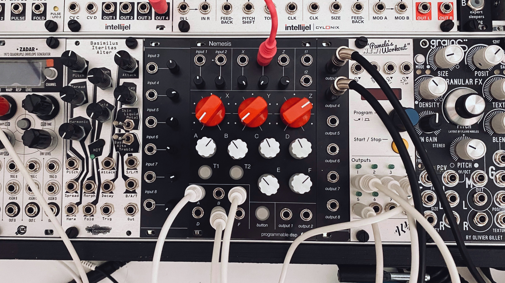

# Nemesis

## multichannel dsp platform for eurorack 

**\hardware** gerber, panel, pcb and schematic files, sorted by hardware revision (rev1, rev2)

**\software** hardware library, FAUST toolchain, programs, firmware and template for both revisions, see [software/README.md](software/README.md)

**\doc** datasheets and additional information

**\media** 

### license

Hardware: 

Software: 

Every source file names its license in an `SPDX-License-Identifier` line
(FAUST programs also in `declare license`). The software is GPL-3.0-or-later
(see LICENSE), except:

- `software/programs/juno.dsp`, `juno106_curves.lib` and
  `software/tools/juno106_presets.py`: GPL-3.0-only. The Juno-106 curves and
  preset conversion follow [Youth106](https://github.com/nagualcode/youth106),
  derived from the [Ultramaster KR-106](https://github.com/kayrockscreenprinting/ultramaster_kr106)
  (GPL v3).
- `software/faust/faust/dsp/nemesis-poly.h`: LGPL-2.1-or-later with the FAUST
  architecture exception (the terms of FAUST's architecture files; offered
  to FAUST as `mcu-poly-dsp.h`).
- `software/faust/nemesis_arch.*`: based on FAUST's Teensy architecture
  (GRAME, LGPL-2.1-or-later), here under GPL-3.0-or-later.
- `software/lib/nemesis/src/fonts`: Michroma and Oxanium, SIL Open Font
  License 1.1 (license files next to them).
- `software/lib/nemesis/teensy41_flash.ld`: based on Teensyduino's
  `imxrt1062_t41.ld` (PJRC).

### specifications

- cirrus cs42448 24 bit audio codec (6 in / 8 out) with additional cs5343 (2 in) 
- teensy 4.1 (arm cortex-m7 at 600 mhz) with 512kb usable `DMAMEM` (can be extended with 2x ESP-PSRAM64 for additional 16mb `EXTMEM`)

- cv Inputs X Y Z with attenuverter
- inputs A-F configurable as cv (0-10V) <u>or</u> ac coupled audio inputs (passive, audio ch. 3-8)
- 2 ch audio in ac or dc coupled with up to 18db gain (full scale at noon 10vpp)
- 2 ch audio out ac or dc coupled (+-5v) 
- **input module:** 6 ac or dc coupled audio-rate inputs with attenuators
- **output module:** 6 ac or dc coupled active audio-rate outputs
